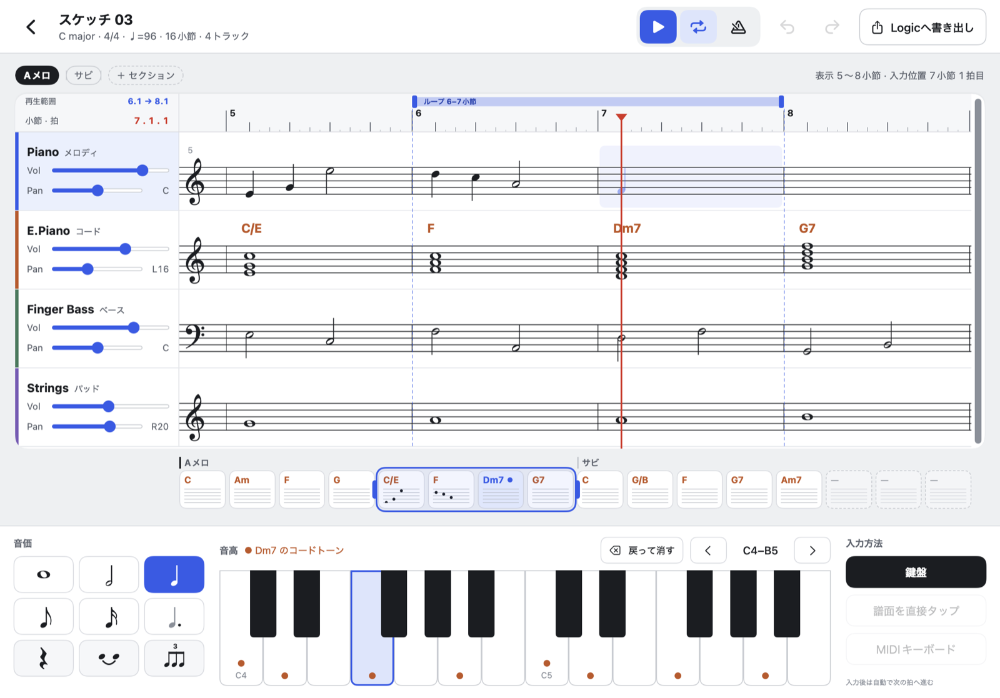

# MusicMemo



コードとメロディを譜面入力でスケッチし、Logic へ書き出すための iPad / Mac アプリ（個人用）。
本格的なアレンジや仕上げは Logic に任せ、思いついたアイデアを素早く残すことに絞っている。

- 全トラックを改行しない横一行の五線で並べ、ピンチで拡大・縮小
- 音価を選んで鍵盤を押すと、編集位置に音符が入って自動で進む
- 曲全体を小節カードで見渡す全体ビュー（横スクロールバーを兼ねる）
- 再生（ループ、ミュート・ソロ、メトロノーム）
- 1曲＝1ファイルで自動保存（iCloud Drive に置けば iPad と Mac で共有）
- MusicXML（コード記号付き）と MIDI で書き出し

## ドキュメント

| ファイル | 内容 |
| --- | --- |
| [docs/APP_SPEC.md](docs/APP_SPEC.md) | いま実装されている仕様（操作、表示のルール、決めた値） |
| [docs/ROADMAP.md](docs/ROADMAP.md) | 今後の課題（未実装の機能、既知の制限） |
| [docs/SPEC.md](docs/SPEC.md) | デザイン段階の画面仕様（元の仕様書） |
| [docs/screens/](docs/screens/)、[docs/reference/](docs/reference/) | 画面のデザインモック（画像と静的 HTML） |
| [THIRD_PARTY_NOTICES.md](THIRD_PARTY_NOTICES.md) | 使っている外部の素材とライセンス |

## セットアップ

必要なもの：Xcode 26 以降、iPadOS 26 / macOS 26 以降、[XcodeGen](https://github.com/yonaskolb/XcodeGen)

```sh
brew install xcodegen          # 未導入なら
Scripts/fetch-soundfont.sh     # 音源（FluidR3_GM、約148MB）を取得。リポジトリには含めていない
xcodegen generate              # MusicMemo.xcodeproj を生成（SoundFont を取得したあとに実行）
open MusicMemo.xcodeproj
```

- SoundFont が無くてもビルド・起動はできる（iPad は音が鳴らない。Mac は macOS 標準の音源で鳴る）
- `.xcodeproj` は生成物なのでリポジトリに含めていない。ファイルを追加・削除したら `xcodegen generate` をやり直す
- モデル層のテスト：`cd Packages/MusicMemoCore && swift test`
- 画面の撮影（開発用、Mac）：`Scripts/snapshot.sh 出力.png [倍率] [入力デモ 0/1]`

## 構成

| パス | 内容 |
| --- | --- |
| `App/Screens/` | 編集画面の全体、トップバー、セクション行 |
| `App/Score/` | 譜面ビュー（五線・音符の描画、ルーラ、再生範囲、ズーム） |
| `App/Overview/` | 全体ビュー |
| `App/InputPalette/` | 入力パレット（音価、鍵盤、入力方法） |
| `App/Store/` | 画面の状態と操作（SketchStore） |
| `App/Document/` | 曲のファイル（DocumentGroup の FileDocument） |
| `App/Audio/` | 鍵盤の音と再生（AVAudioUnitSampler、再生のスケジューラ） |
| `App/Export/` | 書き出しの操作（保存ダイアログ・共有シート） |
| `App/Theme/` | 色と寸法 |
| `App/Debug/` | 開発用の仕組み（デバッグビルドのみ） |
| `Packages/MusicMemoCore/` | 曲データ、ファイル形式、記譜、入力、書き出しの処理（UI に依存しない。テストあり） |
| `Support/Info.plist` | XcodeGen が生成（ファイル形式の登録など。編集は `project.yml` で。リポジトリには含めない） |
| `Scripts/` | 補助スクリプト |

## 一時ファイル（容量を空けるとき）

ビルドや取得で作られ、消しても作り直せるもの。どれも git で除外している。当面この Mac でビルドしないときは消してよい。

| 場所 | 中身 | 大きさの目安 | 消したあと |
| --- | --- | --- | --- |
| `.build/` | `Scripts/snapshot.sh` のビルドの結果（`.build/DerivedData`） | 数百MB〜数GB | 次の `Scripts/snapshot.sh` が最初からのビルドになる |
| `Packages/MusicMemoCore/.build/` | モデル層のテストのビルドの結果 | 数百MB | 次の `swift test` が最初からのビルドになる |
| `App/Resources/SoundFonts/*.sf2` | 音源（FluidR3_GM） | 約148MB | `Scripts/fetch-soundfont.sh` で取り直す（ネットが要る）。取り直すまで iPad では音が鳴らない |
| `MusicMemo.xcodeproj/`、`Support/Info.plist` | XcodeGen が作るプロジェクトと Info.plist | 小さい | `xcodegen generate` で作り直す |
| `.swiftpm/`（各所） | Xcode がパッケージを開いたときの設定 | 小さい | Xcode が作り直す |

消し方（リポジトリの一番上で）：

```sh
rm -rf .build Packages/MusicMemoCore/.build
```

Xcode の `~/Library/Developer/Xcode/DerivedData/MusicMemo-*` も同じ一時ファイル（Xcode の画面からビルドしたとき）。ただし、Xcode から実行中のアプリがあるときは消さない。

### 消さないもの

- 上の表にないもの（`App/`・`Packages/` のソース、`docs/`、`old/`、`Scripts/` など）

## バックアップ（手元にしかないもの）

Mac を移すときやバックアップを取るときに、どれを残し、どれを取り直せばよいか。

### 保存しておくもの（この Mac にしかない）

| 場所 | 中身 | なくしたとき |
| --- | --- | --- |
| まだプッシュしていないコミット、`git stash`、コミットしていない変更 | 作業の途中のもの | 戻らない。バックアップの前にプッシュするか、利用者に確かめる |

ほかに、このリポジトリの中にしかないものはない。

### リポジトリの外で、あわせて残すもの

| 場所 | 中身 | 備考 |
| --- | --- | --- |
| 曲のファイル（1曲＝1ファイル） | 作った曲 | アプリで保存した場所にある。iCloud Drive に置いていれば、この Mac のバックアップには要らない。Mac の中だけに置いた曲があれば写す |
| Claude Code のメモ（`~/.claude/projects/` の下の、このリポジトリの分） | 作業のメモ | Mac ごとに別。新しい Mac では CLAUDE.md を読ませれば作業は続けられる |

### GitHub から取り直せるもの

上の表にないもの全部（ソース、`docs/`、`old/`、`Scripts/` など）。`git clone` で戻る。そのあと「セットアップ」の手順で音源の取得と `xcodegen generate` をし、リポジトリの `user.email` を GitHub の noreply アドレスに設定する。一時ファイル（上の節）は残さなくてよい。
