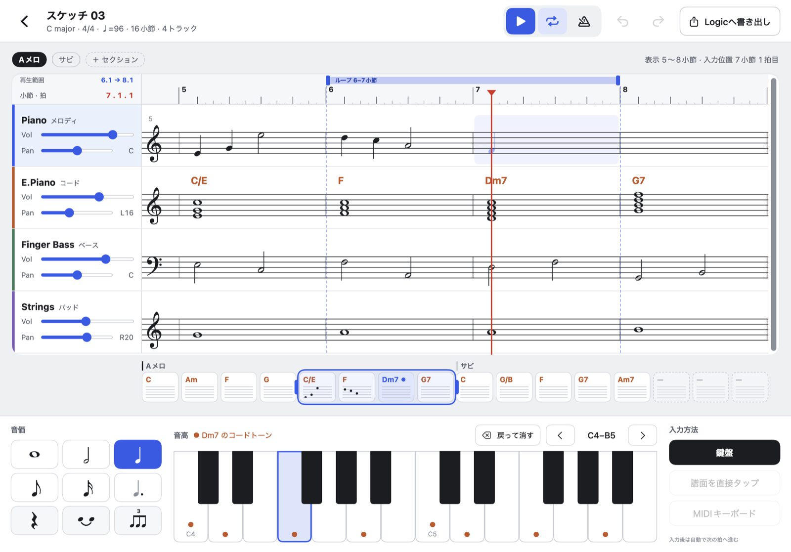

# MusicMemo



コードとメロディを譜面入力でスケッチし、Logic へ書き出すための iPad / Mac アプリ（個人用）。
本格的なアレンジや仕上げは Logic に任せ、思いついたアイデアを素早く残すことに絞っている。

- 全トラックを改行しない横一行の五線で並べ、ピンチで拡大・縮小
- 音価を選んで鍵盤を押すと、編集位置に音符が入って自動で進む
- 曲全体を小節カードで見渡す全体ビュー（横スクロールバーを兼ねる）
- 再生（ループ、ミュート・ソロ、メトロノーム）
- 1曲＝1ファイルで自動保存（iCloud Drive に置けば iPad と Mac で共有）
- MusicXML（コード記号付き）と MIDI で書き出し

## ドキュメント

| ファイル | 内容 |
| --- | --- |
| [docs/APP_SPEC.md](docs/APP_SPEC.md) | いま実装されている仕様（操作、表示のルール、決めた値） |
| [docs/ROADMAP.md](docs/ROADMAP.md) | 今後の課題（未実装の機能、既知の制限） |
| [docs/SPEC.md](docs/SPEC.md) | デザイン段階の画面仕様（元の仕様書） |
| [docs/screens/](docs/screens/)、[docs/reference/](docs/reference/) | 画面のデザインモック（画像と静的 HTML） |
| [THIRD_PARTY_NOTICES.md](THIRD_PARTY_NOTICES.md) | 使っている外部の素材とライセンス |

## セットアップ

必要なもの：Xcode 26 以降、iPadOS 26 / macOS 26 以降、[XcodeGen](https://github.com/yonaskolb/XcodeGen)

```sh
brew install xcodegen          # 未導入なら
Scripts/fetch-soundfont.sh     # 音源（FluidR3_GM、約148MB）を取得。リポジトリには含めていない
xcodegen generate              # MusicMemo.xcodeproj を生成（SoundFont を取得したあとに実行）
open MusicMemo.xcodeproj
```

- SoundFont が無くてもビルド・起動はできる（iPad は音が鳴らない。Mac は macOS 標準の音源で鳴る）
- `.xcodeproj` は生成物なのでリポジトリに含めていない。ファイルを追加・削除したら `xcodegen generate` をやり直す
- モデル層のテスト：`cd Packages/MusicMemoCore && swift test`
- 画面の撮影（開発用、Mac）：`Scripts/snapshot.sh 出力.png [倍率] [入力デモ 0/1]`

## 構成

| パス | 内容 |
| --- | --- |
| `App/Screens/` | 編集画面の全体、トップバー、セクション行 |
| `App/Score/` | 譜面ビュー（五線・音符の描画、ルーラ、再生範囲、ズーム） |
| `App/Overview/` | 全体ビュー |
| `App/InputPalette/` | 入力パレット（音価、鍵盤、入力方法） |
| `App/Store/` | 画面の状態と操作（SketchStore） |
| `App/Document/` | 曲のファイル（DocumentGroup の FileDocument） |
| `App/Audio/` | 鍵盤の音と再生（AVAudioUnitSampler、再生のスケジューラ） |
| `App/Export/` | 書き出しの操作（保存ダイアログ・共有シート） |
| `App/Theme/` | 色と寸法 |
| `App/Debug/` | 開発用の仕組み（デバッグビルドのみ） |
| `Packages/MusicMemoCore/` | 曲データ、ファイル形式、記譜、入力、書き出しの処理（UI に依存しない。テストあり） |
| `Support/Info.plist` | XcodeGen が生成（ファイル形式の登録など。編集は `project.yml` で。リポジトリには含めない） |
| `Scripts/` | 補助スクリプト |
